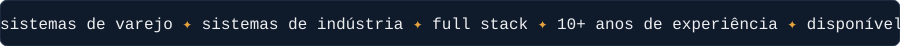

  

  

## Sobre

Sou desenvolvedor web pleno, com mais de 10 anos construindo sistemas para empresas de varejo e indústria. Já passei por todas as camadas de projetos reais: interfaces para o uso diário de operadores, APIs e regras de negócio no backend, modelagem de banco de dados e a infraestrutura que coloca tudo isso no ar.

## Atividade

<picture>
  <source media="(prefers-color-scheme: dark)" srcset="https://raw.githubusercontent.com/BDG27/BDG27/output/github-contribution-grid-snake-dark.svg" />
  <source media="(prefers-color-scheme: light)" srcset="https://raw.githubusercontent.com/BDG27/BDG27/output/github-contribution-grid-snake.svg" />
  
</picture>

## Uso no dia a dia

> Os percentuais acima são uma autoavaliação relativa, não uma métrica medida — ajuste para o que fizer sentido pra você.

## Stack técnica

## Onde atuo

Trabalho principalmente com sistemas de retaguarda para varejo e indústria: controle de estoque, pontos de venda, integrações entre sistemas e painéis operacionais — software que precisa simplesmente funcionar, todos os dias, sob uso real.

## Contato

