  

## Sobre

Sou desenvolvedor web pleno, com mais de 10 anos construindo sistemas para empresas de varejo e indústria. Já passei por todas as camadas de projetos reais: interfaces para o uso diário de operadores, APIs e regras de negócio no backend, modelagem de banco de dados e a infraestrutura que coloca tudo isso no ar.

## Stack técnica

**Frontend** — HTML, CSS e JavaScript como base, com Bootstrap, Tailwind, jQuery e Chart.js para interface e visualização de dados.

**Backend** — Node.js e NestJS, Django e Flask em Python, além de C# e PHP, conforme o que cada sistema exige.

**Infraestrutura** — Linux, Nginx, Azure e AWS para deploy, PostgreSQL, MySQL e MariaDB para dados, Figma para prototipagem.

## Onde atuo

Trabalho principalmente com sistemas de retaguarda para varejo e indústria: controle de estoque, pontos de venda, integrações entre sistemas e painéis operacionais — software que precisa simplesmente funcionar, todos os dias, sob uso real.

## Contato

